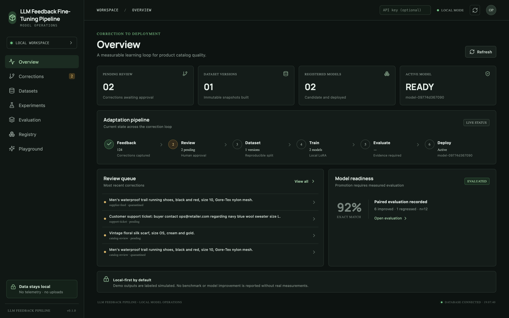
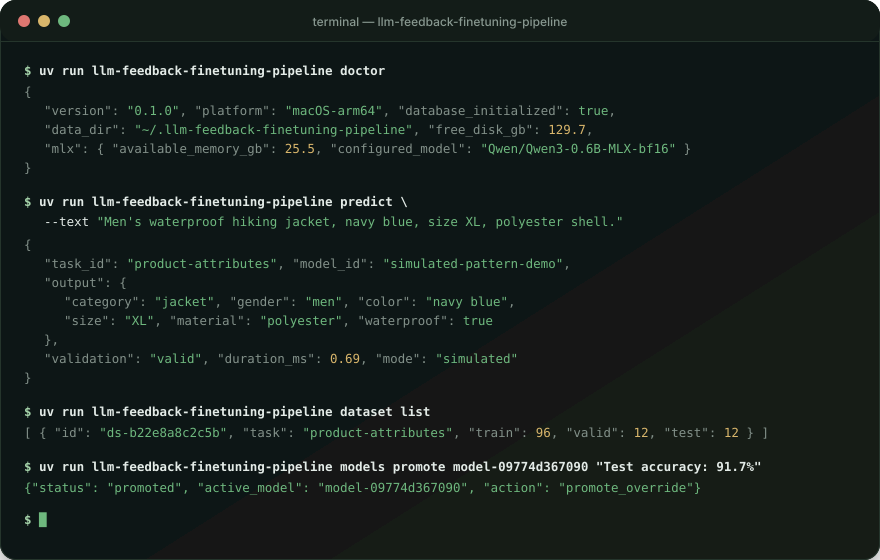
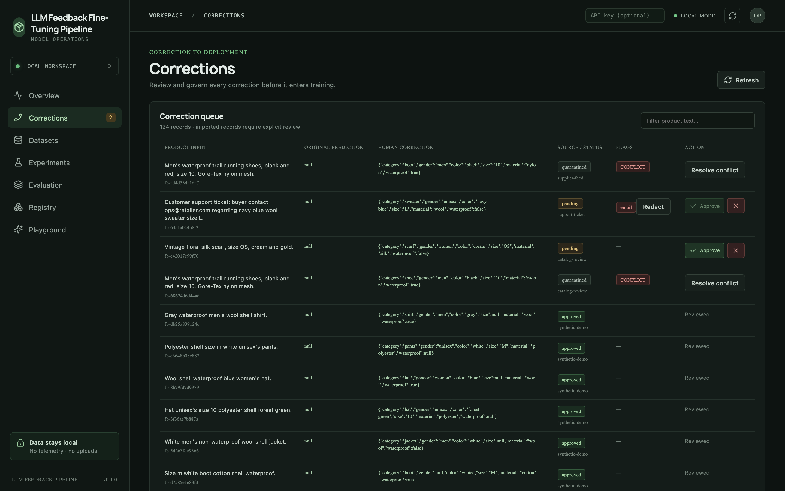
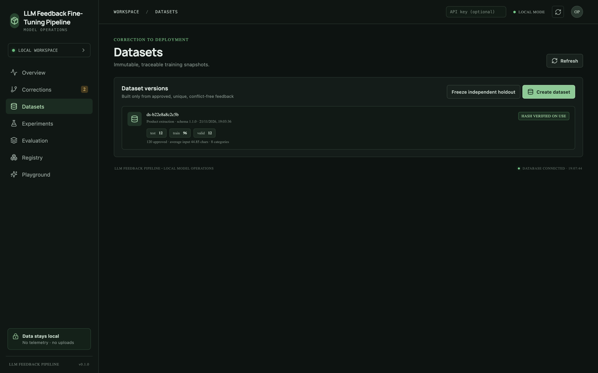
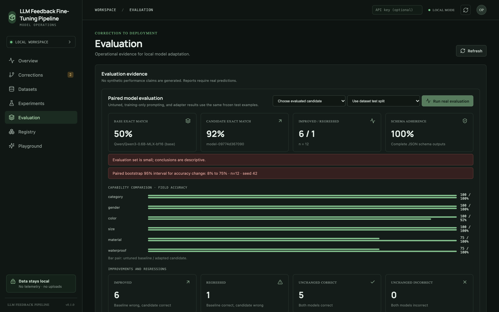
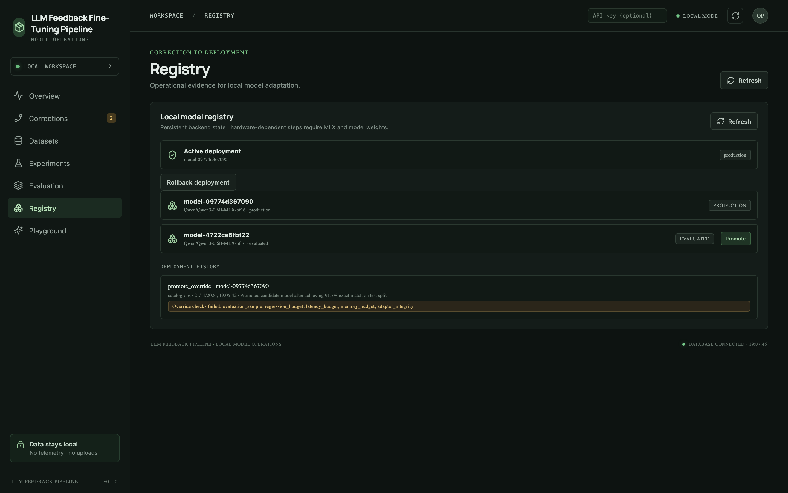
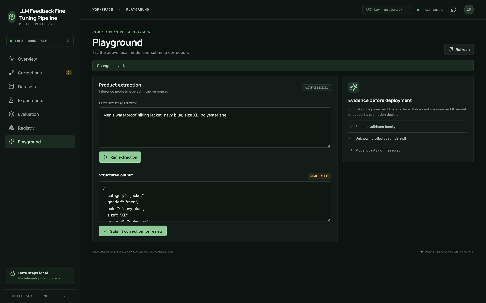
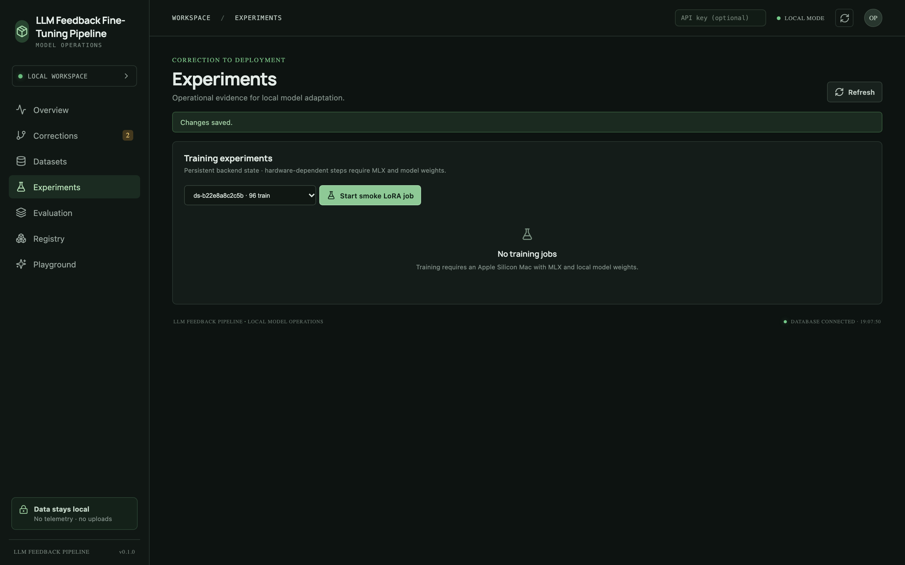

# LLM Feedback Fine-Tuning Pipeline

**Turn business corrections into specialized local AI models.** LLM Feedback Fine-Tuning Pipeline is a local-first system for reviewing human corrections, generating reproducible dataset snapshots, training compact MLX adapters on Apple Silicon, measuring paired regressions against frozen holdouts, and gating deployment.

[](https://github.com/ranajahanzaib/llm-feedback-finetuning-pipeline/actions/workflows/ci.yml) [](LICENSE)

---



_The Operator Console: Tracking the closed-loop pipeline from incoming corrections to versioned datasets, local LoRA experiments, paired evaluations, and gated deployment._

---

## The Problem

Generic large language models regularly make subtle errors on domain-specific product catalogs—guessing missing attributes, confusing categories, hallucinating colors, or generating invalid schemas.

Deploying commercial cloud APIs or sending proprietary catalog data to external providers introduces recurring inference costs, privacy liabilities, and unpredictable regression risks when hosted base models change. Meanwhile, unstructured ad-hoc fine-tuning creates uncontrolled data contamination, unvetted training examples, and silent regressions on previously working inputs.

## The Solution

LLM Feedback Fine-Tuning Pipeline provides an auditable, local-first workflow:

1. **Review & Governance**: Ingest customer service and catalog corrections; automatically quarantine conflicts and detect sensitive information (emails, credentials, phone numbers) before human approval.
2. **Immutable Snapshotting**: Build version-controlled, group-aware training, validation, and test splits with SHA-256 content verification and contamination scanning against prior holdouts.
3. **Local MLX-LM Adaptation**: Train compact LoRA adapters locally using Apple Silicon unified memory without sending proprietary data outside your machine.
4. **Frozen Paired Evaluation**: Benchmark candidate adapters against the un-tuned base model on identical holdout sets, measuring exact-match accuracy, per-field accuracy, schema compliance, and specific regression rates.
5. **Gated Deployment**: Enforce strict promotion policies (evaluation evidence, sample size thresholds, schema adherence) before activating models for localhost API serving.

---

## Terminal Demonstration



---

## Architecture and Workflow

```
Catalog Text ──> Prediction ──> Human Correction ──> Review & Redaction ──> Immutable Dataset
                                                                                   │
┌──────────────────────────────────────────────────────────────────────────────────┘
│
▼
Local MLX LoRA Training ──> Paired Frozen Evaluation ──> Automated Gating ──> Localhost API Serving
```

### Core Architecture Components

| Component                 | Technology                      | Responsibility                                                             |
| :------------------------ | :------------------------------ | :------------------------------------------------------------------------- |
| **CLI & Pipeline Engine** | Python 3.11+, Typer, Pydantic   | Local workflow automation, dataset hashing, and audit trails               |
| **Localhost API**         | FastAPI, Uvicorn, SQLite        | REST endpoints for predictions, reviews, datasets, and models              |
| **Operator Console**      | React 18, Vite, TypeScript, CSS | Dark-mode interface for catalog ops, evaluation inspection, and playground |
| **Model Runtime**         | MLX, MLX-LM (Apple Silicon)     | Hardware-accelerated local LoRA fine-tuning and inference                  |
| **Evaluation Engine**     | Scikit-Learn, NumPy             | Paired bootstrap intervals, exact-match scoring, error classification      |

---

## Interface Tour

### 1. Correction Queue & Privacy Redaction

Review incoming corrections, inspect diffs against model predictions, adjudicate conflicting inputs, and redact detected PII before approval.



### 2. Immutable Dataset Versions

Every snapshot generates reproducible `train.jsonl`, `valid.jsonl`, and `test.jsonl` splits with SHA-256 manifests, attribute distribution statistics, and test-input contamination checks.



### 3. Paired Model Evaluation

Directly compare the un-tuned base model against fine-tuned adapters on frozen holdouts. Inspect exact-match improvements, per-field accuracy deltas, and specific regressed examples.



### 4. Model Registry & Audit Trail

Gate promotion based on attached evaluation evidence and minimum sample requirements. Maintain an immutable audit log of promotions and rollbacks.



### 5. Interactive Testing Playground

Test product attribute extraction against the active production model or simulated demo pattern, with instant one-click submission of corrections back to the review queue.



### 6. Local Experiment Tracking

Monitor local MLX LoRA training jobs across `smoke`, `standard`, and `extended` presets directly from the console.



---

## Installation & Setup

### Prerequisites

- Python 3.11, 3.12, or 3.13 and [uv](https://docs.astral.sh/uv/)
- Node.js 20+ and [pnpm](https://pnpm.io/) (for the Operator Console)
- _Optional for real model training/inference:_ macOS on Apple Silicon (M1/M2/M3/M4) with MLX

### 1. Clone & Set Up Python Environment

```bash
git clone https://github.com/ranajahanzaib/llm-feedback-finetuning-pipeline.git
cd llm-feedback-finetuning-pipeline
uv sync --extra dev
```

### 2. Initialize and Verify System Readiness

```bash
uv run llm-feedback-finetuning-pipeline init
uv run llm-feedback-finetuning-pipeline doctor
```

Output:

```json
{
  "version": "0.1.0",
  "python": "3.12.11",
  "platform": "macOS-arm64",
  "data_dir": "~/.llm-feedback-finetuning-pipeline",
  "database_initialized": true,
  "free_disk_gb": 129.7,
  "mlx": {
    "available": false,
    "available_memory_gb": 25.5,
    "configured_model": "Qwen/Qwen3-0.6B-MLX-bf16"
  }
}
```

### 3. (Optional) Install MLX for Real Local Fine-Tuning

```bash
uv sync --extra mlx --extra dev
```

The default base model reference is `Qwen/Qwen3-0.6B-MLX-bf16`. Set `LLM_FEEDBACK_FINETUNING_PIPELINE_MODEL` to any compatible Hugging Face or local model directory.

---

## Quick Start (Interactive Demo)

Experience the entire loop immediately using the deterministic demo dataset:

### Step 1: Start the Backend & Seed Demo Data

```bash
# Seed 120 deterministic catalog corrections
uv run llm-feedback-finetuning-pipeline demo

# Start the localhost API server (port 8000)
uv run llm-feedback-finetuning-pipeline serve
```

Interactive OpenAPI documentation is available at `http://127.0.0.1:8000/docs`.

### Step 2: Start the Operator Console

In a second terminal:

```bash
cd web
pnpm install
pnpm run dev
```

Open `http://127.0.0.1:5173` in your browser.

### Step 3: Build a Versioned Dataset

```bash
uv run llm-feedback-finetuning-pipeline dataset build --train-pct 0.8 --valid-pct 0.1 --test-pct 0.1
```

Inspect the generated manifest and split counts:

```bash
uv run llm-feedback-finetuning-pipeline dataset list
```

---

## Practical Workflows

### 1. Ingesting and Reviewing Corrections

Import corrections from CSV or JSONL format. Preview records first without modifying the database:

```bash
# Dry-run validation check
uv run llm-feedback-finetuning-pipeline feedback import corrections.jsonl

# Commit records to the review queue
uv run llm-feedback-finetuning-pipeline feedback import corrections.jsonl --commit

# List pending feedback
uv run llm-feedback-finetuning-pipeline feedback list --status pending

# Approve a correction
uv run llm-feedback-finetuning-pipeline feedback review fb-0122db48e376 approved --reviewer "catalog-ops"
```

#### JSONL Format Example

```json
{
  "input_text": "Men's waterproof hiking jacket, navy blue, size XL, polyester shell.",
  "corrected_output": {
    "category": "jacket",
    "gender": "men",
    "color": "navy blue",
    "size": "XL",
    "material": "polyester",
    "waterproof": true
  },
  "source": "catalog-review",
  "notes": "Verified against physical inventory"
}
```

### 2. Privacy Redaction & Conflict Handling

- **PII Detection**: Heuristics flag phone numbers, email addresses, and API credential patterns. Flagged records cannot be approved until redacted.
- **Redaction**: Execute `uv run llm-feedback-finetuning-pipeline feedback redact <id>` or click **Redact** in the console.
- **Quarantine**: If identical input texts receive conflicting corrections, both records are quarantined until an operator adjudicates the authoritative label.

### 3. Local LoRA Fine-Tuning (Apple Silicon)

```bash
# Start a smoke-test LoRA training job (20 iterations)
uv run llm-feedback-finetuning-pipeline train start <dataset-id> --preset smoke

# Monitor training jobs
uv run llm-feedback-finetuning-pipeline train status

# Inspect a specific job
uv run llm-feedback-finetuning-pipeline train status <experiment-id>
```

Supported training presets:

- `smoke`: 20 iterations, batch size 1 (pipeline verification)
- `standard`: 500 iterations, batch size 2, val batches 25
- `extended`: 1500 iterations, batch size 2, val batches 50

### 4. Paired Holdout Evaluation

Evaluate the candidate model against the frozen test split:

```bash
uv run llm-feedback-finetuning-pipeline evaluate run <dataset-id> <candidate-model-id>
```

Metrics reported:

- Exact-match accuracy comparison (base vs candidate)
- Per-field accuracy for `category`, `gender`, `color`, `size`, `material`, `waterproof`
- Count of improved vs regressed examples
- Regression rate of previously correct baseline predictions
- 95% paired bootstrap confidence interval

### 5. Production Gating & Rollback

```bash
# Promote an evaluated model
uv run llm-feedback-finetuning-pipeline models promote <model-id> "Surpasses 90% accuracy on test holdout"

# Roll back to the previous deployment if an issue is detected
uv run llm-feedback-finetuning-pipeline models rollback "Rollback due to edge case regression"
```

---

## API Reference

The localhost API binds to `127.0.0.1:8000` by default.

### Key Endpoints

| Method | Endpoint                                   | Description                                             |
| :----- | :----------------------------------------- | :------------------------------------------------------ |
| `GET`  | `/health`                                  | System health check (`{"status": "ok"}`)                |
| `GET`  | `/ready`                                   | Database connection, active model, and MLX availability |
| `POST` | `/api/v1/tasks/product-attributes/predict` | Run extraction on raw product text                      |
| `GET`  | `/api/v1/feedback`                         | List feedback records with status/source filters        |
| `POST` | `/api/v1/feedback`                         | Ingest new feedback record                              |
| `POST` | `/api/v1/feedback/{id}/review`             | Approve or reject a feedback item                       |
| `POST` | `/api/v1/feedback/{id}/redact`             | Redact sensitive patterns from a record                 |
| `POST` | `/api/v1/feedback/{id}/resolve-conflict`   | Adjudicate conflicting corrections                      |
| `POST` | `/api/v1/datasets/build`                   | Build immutable snapshot from approved records          |
| `GET`  | `/api/v1/datasets`                         | List all dataset snapshots                              |
| `POST` | `/api/v1/train/jobs`                       | Submit a local MLX LoRA training job                    |
| `GET`  | `/api/v1/experiments`                      | List experiment runs and worker statuses                |
| `GET`  | `/api/v1/models`                           | List candidate and active models                        |
| `POST` | `/api/v1/models/{id}/promote`              | Evaluate gates and promote model to active              |
| `POST` | `/api/v1/models/rollback`                  | Roll back to prior active deployment                    |
| `POST` | `/api/v1/evaluations`                      | Execute paired evaluation run                           |
| `POST` | `/api/v1/benchmarks/cost`                  | Calculate amortized inference & hardware costs          |

Interactive Swagger documentation is available at `http://127.0.0.1:8000/docs`.

---

## Configuration

Set environment variables in your environment or process manager:

| Variable                                    | Default                                                      | Purpose                                                        |
| :------------------------------------------ | :----------------------------------------------------------- | :------------------------------------------------------------- |
| `LLM_FEEDBACK_FINETUNING_PIPELINE_HOME`     | `~/.llm-feedback-finetuning-pipeline` (or `.data/` fallback) | Directory for SQLite database and training artifacts           |
| `LLM_FEEDBACK_FINETUNING_PIPELINE_DATABASE` | `None` (uses `$HOME/...sqlite3`)                             | Custom SQLite connection path                                  |
| `LLM_FEEDBACK_FINETUNING_PIPELINE_MODEL`    | `Qwen/Qwen3-0.6B-MLX-bf16`                                   | Default Hugging Face or local model reference                  |
| `LLM_FEEDBACK_FINETUNING_PIPELINE_MODE`     | `simulated`                                                  | `simulated` for demo pattern matching, `mlx` for local weights |
| `LLM_FEEDBACK_FINETUNING_PIPELINE_API_KEY`  | `None`                                                       | Optional admin API key (`X-LLM-Feedback-Key` header)           |

---

## Development & Testing

Run the full automated test and verification suite:

```bash
# Python unit tests
uv run pytest

# Python linting and code formatting
uv run ruff check src tests

# Static type checking
uv run mypy src/llm_feedback_finetuning_pipeline

# Frontend unit tests and build verification
cd web
pnpm test
pnpm run build
```

Alternatively, run everything via the `Makefile`:

```bash
make test
make lint
make typecheck
make web-build
```

---

## Privacy & Security

- **Zero Telemetry**: No usage metrics, user telemetry, or tracking are collected.
- **Local-First Data**: All feedback records, dataset files, and adapter weights remain strictly on the local filesystem.
- **Localhost Default**: The API server binds strictly to `127.0.0.1`.
- **Pre-Approval Scanners**: Regex heuristics check for email, phone, and credential patterns before data enters the training split.
- **Audited Deletions**: Records can be deleted prior to dataset snapshotting. Once included in an immutable snapshot, deletion is rejected to preserve scientific auditability.

---


## License & Custom Work

[](mailto:work@withrana.com) [](https://www.linkedin.com/in/workwithrana)
[](https://www.upwork.com/freelancers/~01bbcf6edb91a8df5f)
[](https://contra.com/ranajahanzaib/)

**License:** MIT. Free for personal and commercial use.

**Author:** Rana Jahanzaib

**Need this built for your stack?** Email me what you're working on: work@withrana.com
